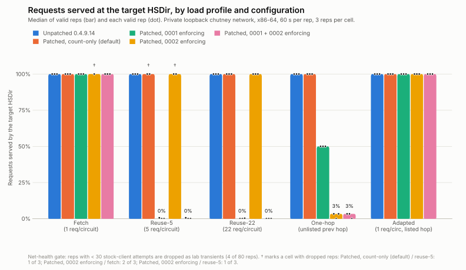
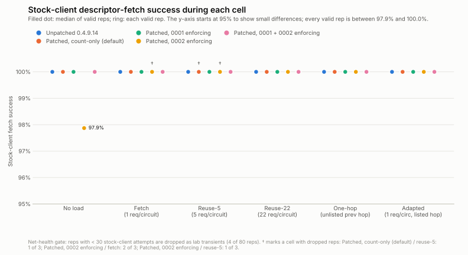
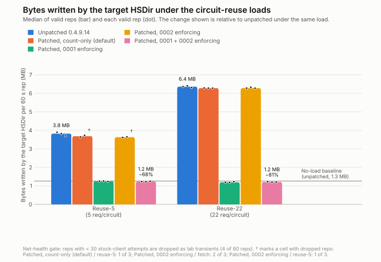

# Closed-lab off-vs-on charts (x86-64)

These charts are drawn from the closed-lab benchmark's raw matrix,
`simulator/results/results-x86-full.csv` on branch
`tor41339-hsdir-defense` (commit 33ad73b). That run used a private,
loopback-only chutney network with its own authorities and consensus, five
configurations × six load profiles, 3 reps of 60 s per cell, and one
target HSDir. Load-profile definitions and the findings narrative are in the
benchmark report (`simulator/results/offvson-report-x86.md`).

**Numbering note.** The `0001` / `0002` configuration labels below are the raw
run labels from `results-x86-full.csv` and follow the **pre-reorder** numbering,
which is the **inverse** of the shipped `patches/` numbering: here `0001` is the
**one-request-per-circuit / circuit-close** defense (shipped **`patches/0002`**,
`HSDirOneRequestPerCircuit`, counter `hsdir_circ_reused`) and `0002` is the
**unknown-previous-hop / 503-refusal** defense (shipped **`patches/0001`**,
`HSDirRefuseUnknownPrevHop`, counter `hsdir_unknown_prev_hop`). Defense
**names** are authoritative; the labels are left as recorded so these figures
stay in sync with the un-edited CSV.

**Method.**
- A rep counts as valid only if its stock client made at least 30 attempts.
  This is the same gate as `simulator/scripts/analyze.py`: 4 of 80 reps fall
  below it and are dropped as lab transients. They are annotated (†), never
  hidden.
- Bars and filled dots are medians of valid reps. Small dots and rings are
  the individual valid reps.
- "Served" is `median(load_recv) / median(load_issued)`, as in
  `analyze.py`.
- The table view is in `charts-data.csv` / `charts-data.md`, and
  `make_charts.py` regenerates everything:

  ```
  python3 make_charts.py ../results-x86-full.csv <outdir>
  ```
- Colors are the first five categorical slots of the dataviz reference
  palette. They were checked with the palette validator for adjacent pairs:
  worst CVD ΔE 9.1 in light mode, 8.4 in dark. Light and dark variants are
  provided.

## 1. Requests served at the target HSDir

<picture>
  <source media="(prefers-color-scheme: dark)" srcset="served-fraction-dark.svg">
  
</picture>

Readings, as valid-rep medians:
- **Fetch (one request per circuit) and adapted:** 100% served in every
  configuration.
- **Reuse-5 and reuse-22:**
  - 100% served unpatched, in count-only and with 0002 enforcing (the
    unknown-previous-hop defense = shipped `patches/0001`, which does not act on
    circuit reuse);
  - **~0% received by the test client** with 0001 enforcing (the
    one-request-per-circuit defense = shipped `patches/0002`), alone or together
    with 0002. The HSDir still serves one descriptor per circuit (the 1/n
    floor); the ~0% is a client-side pipelining artifact, not zero service (the
    circuit-close on request #2 tears down request #1's in-flight response). The
    honest within-build figure is the byte reduction — see the −81% / −67%
    drops in §3.
- **One-hop:**
  - 100% served unpatched and in count-only;
  - 3% with 0002 enforcing (the unknown-previous-hop defense = shipped
    `patches/0001`), alone or together with 0001;
  - 50% with 0001 alone (the one-request-per-circuit defense = shipped
    `patches/0002`).

## 2. Stock-client success during each cell

<picture>
  <source media="(prefers-color-scheme: dark)" srcset="stock-client-success-dark.svg">
  
</picture>

Every valid rep falls between 97.9% and 100%. Every median under load is
100%. The single 97.9% value is a no-load cell with one rep (`patched-0002`,
`none`). In this matrix, enforcement did not reduce stock-client success
under any load profile.

## 3. Bytes written by the target under the circuit-reuse loads

<picture>
  <source media="(prefers-color-scheme: dark)" srcset="target-bytes-reuse-dark.svg">
  
</picture>

Bytes written per 60 s rep, valid-rep medians:

| Load | Unpatched | Count-only | 0001 | 0002 | 0001 + 0002 |
|---|---|---|---|---|---|
| reuse-5 | 3.82 MB | 3.68 | 1.25 (−67%) | 3.63 | 1.23 (−68%) |
| reuse-22 | 6.36 MB | 6.28 | 1.19 (−81%) | 6.28 | 1.21 (−81%) |

Percentages are relative to unpatched under the same load. With 0001
enforcing (the one-request-per-circuit defense = shipped `patches/0002`), the
target writes about as much as the no-load baseline (0.87 to
1.26 MB across configurations). The within-build A/B gives the same result:
count-only → 0001 + 0002 enforcing is −67% for reuse-5 and −81% for
reuse-22.

## Observations that need follow-up (reported as found)

- **Absolute bytes may not be comparable across builds.**
  - Under the fetch and adapted loads, every patched configuration writes
    about 30% less than unpatched: 1.62–1.69 MB vs 2.41–2.42 MB. That
    includes count-only mode, which should behave exactly like unpatched for
    one-request-per-circuit traffic. The served fraction there is 100%
    everywhere.
  - Until that is explained, treat unpatched-vs-patched comparisons of
    absolute bytes as possibly confounded, for example by separate
    network-instance bring-ups or run order. Prefer the within-build A/B
    (count-only vs enforcing), which gives the same reuse-load result.
  - Suggested check: rerun unpatched and count-only fetch cells interleaved
    on one network instance.
- **One-hop with 0001 alone (the one-request-per-circuit defense = shipped
  `patches/0002`) serves 50%.** That is a median of 3 reps
  (`hsdir_circ_reused` 15). The benchmark report covers how that load
  profile groups its requests. These charts only report the figure.
- **Target CPU is not charted.** In every cell it is about 1% of one core,
  too low at this lab load to tell configurations apart.
- **Scope.** This is a small lab network running on one host. These
  results show the direction of each effect in each configuration; they are
  not network-scale magnitudes.
